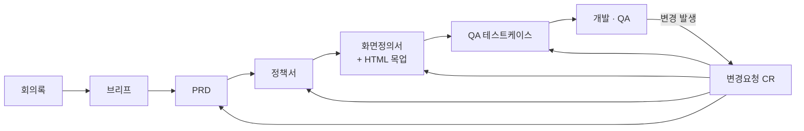

# PlanLoop 소개서

> 웹앱을 만들기 전에 **되묻지 않는 스펙 세트**를 만들고,
> 개발·QA 중 생기는 변경을 그 스펙에 계속 되돌려 넣는 Claude Code 기반 기획 시스템

| 항목 | 내용 |
|---|---|
| 문서 버전 | v1.0 |
| 작성일 | 2026-09-02 |
| 대상 독자 | 기획자, PM, 개발자, QA, 그리고 이 저장소를 처음 여는 사람 |
| 실행 환경 | Claude Code (CLI / VS Code 확장 / 데스크톱) |

---

## 1. PlanLoop이란 무엇인가

PlanLoop은 **웹 애플리케이션 개발 전(前) 단계의 기획 산출물을 만들고 유지하는 시스템**이다.
코드를 실행하는 프레임워크가 아니라, **문서 규칙(CLAUDE.md) + 템플릿 + 슬래시 커맨드**로 이루어진 작업 방식이다.

이름 그대로 두 부분으로 되어 있다.

- **Plan** — 회의 → 브리프 → PRD → 정책서 → 화면 → 테스트케이스로 이어지는 기획 파이프라인
- **Loop** — 개발·QA 중 발생한 변경을 다시 기획 문서로 되돌려 넣는 순환 루프



### 왜 필요한가

기획 문서가 있는데도 개발 중에 질문이 끊이지 않는 이유는 대개 하나다. **문서가 검사할 수 없게 쓰여 있기 때문이다.**

| 흔한 문장 | 무슨 일이 벌어지나 |
|---|---|
| "입력값을 적절히 검증한다" | 개발자가 기획자에게 묻는다. 답이 늦으면 임의로 정한다 |
| "오류 시 안내 메시지를 보여준다" | 문구를 개발자가 만든다. QA가 다시 문제 삼는다 |
| "빠르게 로딩되어야 한다" | 테스트할 수 없다. 통과 기준이 없다 |

PlanLoop은 이 문장들을 **수치·조건·문구 원문**으로 강제한다.
"2~50자", "LCP 2.5초 이내", 「입금 확인까지 2~3일 정도 걸릴 수 있습니다.」처럼 **그대로 구현하고 그대로 테스트할 수 있는 형태**로 쓴다.

### 핵심 철학 — 되묻지 않는 스펙

기획 산출물의 1차 독자는 **사람(팀원)과 구현 AI(Claude Code) 둘 다**이다.
아래 4종이 세트로 갖춰져야 구현자가 기획자에게 되묻지 않고 개발할 수 있다. 하나라도 빠지면 그 지점에서 질문이 생긴다.

| 문서 | 답하는 질문 |
|---|---|
| PRD | **왜, 무엇을** 만드는가 |
| 정책서 | **어떤 규칙으로 검증**하는가 |
| IA + 화면정의서 | **어떻게 보이고 동작**하는가 |
| QA 테스트케이스 | **어떻게 확인**하는가 |

---

## 2. 무엇을 할 수 있는가

### 2.1 산출물 8종을 생성한다

| 산출물 | 파일 | 내용 |
|---|---|---|
| 회의록 | `minutes/` | 회의 결정사항 원본 보관 — 추적 체인의 출발점 |
| 프로젝트 브리프 | `00-brief.md` | 문제 정의, 타깃, 핵심 기능, 제약 (1~2장) |
| PRD | `01-prd.md` | 기능 요구사항(REQ) + 인수 조건, 비기능 요구사항(NFR), 일정, 리스크 |
| 정책서 | `02-policy.md` | 검증 가능한 규칙(POL) — 적용 시점, 위반 문구, 검증 의사코드까지 |
| IA | `03-ia.md` | 사이트맵, 화면 목록(SCR), 사용자 흐름도 (Mermaid) |
| 화면정의서 | `04-screens/SCR-###.md` | 레이아웃 + 컴포넌트 트리 + 상태 4종 + 유효성 |
| HTML 와이어프레임 | `04-screens/SCR-###.html` | 브라우저에서 바로 여는 로파이 목업 (+ `index.html` 전체 뷰어) |
| QA 테스트케이스 | `05-qa-tc.md` | 실행 가능한 검증 절차(TC) — 모든 P0 REQ·POL 커버 |

### 2.2 모든 항목을 번호로 역추적할 수 있다

문서 간 참조는 문장이 아니라 **ID**로 한다.

```
회의 결정(minutes/) → REQ-### (PRD) → POL-### (정책) → SCR-### (화면) → TC-### (테스트)
                        └── 변경은 CR-###이 체인 전체를 관통한다
```

| 접두어 | 대상 | 정의 위치 |
|---|---|---|
| `REQ-###` | 기능 요구사항 | `01-prd.md` |
| `NFR-###` | 비기능 요구사항 | `01-prd.md` |
| `POL-###` | 정책 | `02-policy.md` |
| `SCR-###` | 화면 | `03-ia.md`(목록), `04-screens/`(상세) |
| `TC-###` | 테스트케이스 | `05-qa-tc.md` |
| `CR-###` | 변경요청 | `changes/` |

덕분에 **"이 화면의 이 버튼이 왜 여기 있나?"** 라는 질문에 TC → POL → REQ → 회의 결정까지 번호로 거슬러 올라가 답할 수 있다.
ID는 한 번 부여하면 재사용·변경하지 않고, 삭제된 ID는 결번으로 남긴다.

### 2.3 정책을 "테스트할 수 있는 규칙"으로 쓴다

모든 정책(POL)은 **6요소**를 갖춘다. 정책 문서 자체가 스펙이자 테스트 기준이 된다.

① 규칙 한 문장 ② 적용 시점 ③ 위반 시 처리 + 사용자에게 보여줄 **문구 원문** ④ 예외 ⑤ 검증 의사코드 ⑥ 관련 TC 번호

실제 예 ([projects/revival-ops/02-policy.md](projects/revival-ops/02-policy.md)의 POL-007, 일부 축약):

```markdown
### POL-007 입금 확인 소요

- **규칙**: 입금 확인까지 2~3일이 소요될 수 있음을 마이페이지와 접수 완료 화면에 상시 안내한다.
- **적용 시점**: 접수 완료 화면 진입 시, 마이페이지 입금 상태 영역 바로 아래
- **위반/실패 시 처리**: 문구 「입금 확인까지 2~3일 정도 걸릴 수 있습니다. 입금하셨다면
  조금만 기다려 주세요.」 이 문구가 노출되지 않으면 정책 위반으로 본다.
- **예외**: 입금이 확인된 참가자에게도 노출 위치는 유지하되 문구는 확인 완료 표시로 대체한다.
- **배경·근거**: 은행 내역을 모아 확인하므로 즉시 반영되지 않는다.
  「방금 입금했는데 왜 신청 완료가 안 돼 있냐」는 문의가 많아 응대량을 줄이려는 목적이다.
- **검증 의사코드**: (실제 문서에는 JS 의사코드가 들어간다)
- **관련 요구사항**: REQ-011, REQ-013
```

이렇게 쓰면 개발자는 문구를 지어내지 않고, QA는 통과 기준을 따로 물을 필요가 없다.

### 2.4 화면을 문서와 목업 두 벌로 만든다

화면 하나당 파일 두 개가 **쌍으로** 생성된다.

- `SCR-001-접수홈.md` — ASCII 레이아웃 + 컴포넌트 트리 + 상태 4종(기본/로딩/빈/에러) + 유효성 규칙
- `SCR-001-접수홈.html` — 브라우저에서 바로 여는 로파이 목업

`04-screens/index.html`은 전체 화면을 한눈에 보는 뷰어다. 화면을 추가·삭제하면 이 목록도 함께 갱신된다.
둘은 **항상 같은 내용**을 유지하는 것이 규칙이며, `/plan-status`가 불일치를 잡아낸다.

### 2.5 개발 중 변경을 문서에 되돌려 넣는다 (Loop)

이 부분이 일반적인 "문서 생성기"와 PlanLoop이 갈라지는 지점이다.

문서는 `초안(Draft)` → `검토중(Review)` → `승인(Approved)` 상태를 가진다.
**승인된 문서는 직접 수정하지 않는다.** 반드시 변경요청(CR)을 거친다.

```
QA 이슈 발생
  → /change        CR 문서 작성 (AS-IS / TO-BE / 영향받는 ID 전체 목록)
  → 사람이 승인
  → /merge-change  정책서 + 화면정의서 + HTML 목업 + TC + CHANGELOG 일괄 갱신
  → CR 파일은 changes/merged/ 로 이동 (이력 보관)
```

**예시**: QA에서 "로그인 5회 실패 시 잠금 해제 수단이 없다"가 나오면 →
`/change`가 POL-001(정책) + SCR-002(로그인 화면) + 관련 TC의 영향을 분석한 CR을 만들고 →
승인 후 `/merge-change`가 정책서·화면정의서·HTML 목업·테스트케이스·CHANGELOG를 한 번에 갱신한다.
문서 하나만 고치고 나머지가 어긋나는 일이 구조적으로 막힌다.

### 2.6 구현이 앞서갔을 때 2단계로 동기화한다

개발이 진행되면 구현이 문서보다 앞서가는 일이 반드시 생긴다.
`/sync-impl`은 **비교와 수정을 한 턴에 하지 않는다.**

1. **1단계 — 비교**: 코드와 문서의 차이만 리포트한다. 이때 어떤 문서도 수정하지 않는다.
2. **판단**: 어느 쪽이 맞는지는 **사람이 정한다.** (구현이 맞으면 문서 수정, 문서가 맞으면 코드 수정)
3. **2단계 — 반영**: 판단 결과대로 문서에 반영한다.

### 2.7 완료 여부를 기계적으로 검사한다

"완료"를 감이 아니라 조건으로 정의한다. `/plan-status`가 전부 자동 검사한다.

| 산출물 | 완료 조건 |
|---|---|
| `00-brief.md` | 모든 표 항목이 채워짐("미정 — 확인 필요" 허용), 2페이지 이내 |
| `01-prd.md` | 모든 REQ에 인수 조건 체크박스 2개 이상, P0 REQ에 POL·SCR 연결, 검증 불가 표현 없음, 리스크 1개 이상 |
| `02-policy.md` | 모든 POL이 6요소를 갖춤 |
| `04-screens/` | 화면마다 .md/.html 쌍 존재, 구성요소 번호 일치, 상태 4종 정의, index.html 등재 |
| `05-qa-tc.md` | 모든 P0 REQ에 TC 1개 이상, 모든 POL에 위반 케이스 TC 1개 이상 |

`/plan-status`는 이 밖에 깨진 ID 참조, .md/.html 불일치, 미해결 CR, 문서 버전·상태도 함께 리포트한다.

---

## 3. 어떻게 사용하는가

### 3.1 준비

1. 이 저장소를 클론한다.
2. 저장소 폴더에서 **Claude Code**를 연다 (CLI `claude`, VS Code 확장, 또는 데스크톱 앱).
3. 끝이다. 별도 설치·빌드·의존성이 없다. `CLAUDE.md`가 자동으로 읽히고 `.claude/skills/`의 슬래시 커맨드가 활성화된다.

### 3.2 기획 단계 — 프로젝트 시작부터 스펙 세트 완성까지

순서대로 실행한다. 각 단계는 앞 단계 산출물을 입력으로 쓴다.

| 순서 | 커맨드 | 하는 일 | 만들어지는 것 |
|---|---|---|---|
| 1 | `/plan-init` | 인터뷰로 프로젝트 정보를 수집 | 폴더 구조 + `00-brief.md` |
| 2 | `/minutes` | 회의록·녹취 전사 → 결정사항 7개 이내 요약 → 확인 후 반영 | `minutes/` + 브리프·PRD 반영 |
| 3 | `/prd` | 브리프 → 요구사항에 ID 부여, 인수 조건·리스크 작성 | `01-prd.md` |
| 4 | `/policy` | PRD → 각 요구사항에서 필요한 규칙을 6요소로 도출 | `02-policy.md` |
| 5 | `/wireframe` | PRD·정책서 → IA + 화면정의서 + HTML 목업 | `03-ia.md`, `04-screens/` |
| 6 | `/qa-tc` | 전체 → 모든 P0 REQ·POL에 테스트케이스 연결 | `05-qa-tc.md` |

각 문서가 완성되면 검토 후 문서정보 표의 상태를 `승인(Approved)`으로 바꾼다 (최초 승인 = v1.0).
**승인 이후에는 직접 수정하지 않는다.**

> `/minutes`는 2번 자리에만 있는 게 아니다. 회의는 계속 열리므로 언제든 다시 쓴다.
> 회의에서 결정되지 않은 것을 결정으로 승격하지 않는 것이 이 커맨드의 규칙이다.

### 3.3 개발·QA 단계 — 변경 역반영

| 커맨드 | 언제 쓰나 |
|---|---|
| `/change` | 변경이 발생했을 때 — 영향 분석을 포함한 CR 문서 작성 (`changes/open/`) |
| `/merge-change` | CR이 승인된 후 — 관련된 모든 산출물에 일괄 반영 + CHANGELOG 기록 |
| `/sync-impl` | 구현이 문서보다 앞서갔을 때 — ①차이 리포트 → ②사람 판단 → ③반영 |
| `/plan-status` | 아무 때나 — 현황·정합성·완료 정의 충족 여부 점검 |

개발·QA 중 "이 기능 바꿔야 해", "QA에서 이슈 나왔어" 같은 말이 나오면
승인된 문서를 바로 고치지 말고 `/change`부터 시작한다.

### 3.4 실제 사용 흐름 예시

```
[월요일] 킥오프 회의 녹취를 받았다
  /minutes            → 결정사항 6개 요약 → 확인 → minutes/2026-09-01-킥오프.md 저장
  /plan-init          → projects/my-app/ 생성 + 00-brief.md
[화요일]
  /prd                → REQ-001~REQ-032, NFR-001~005 부여
  /policy             → POL-001~POL-018 (6요소로)
[수요일]
  /wireframe          → 화면 14개, .md/.html 28개 + index.html 뷰어
  /qa-tc              → TC-001~TC-061
  /plan-status        → DoD 검사 통과 → 문서 상태를 승인으로 변경 (v1.0)
[개발 3주차] QA: "결제 실패 시 재시도 안내가 없다"
  /change             → CR-001 작성 (POL-009, SCR-007, TC-034 영향)
  (사람이 CR 승인)
  /merge-change       → 정책서 v1.1 + 화면정의서 + 목업 + TC + CHANGELOG 갱신
```

---

## 4. 폴더 구조

```
CLAUDE.md            운영 규칙 — Claude가 따르는 규범 (이 파일이 시스템의 본체)
README.md            요약
INTRODUCTION.md      이 문서
templates/           산출물 템플릿 8종 (직접 수정하지 않고 복사해서 사용)
.claude/skills/      슬래시 커맨드 10종 정의
projects/<이름>/     프로젝트별 산출물
  ├── minutes/           회의록 원본 + 결정→ID 매핑
  ├── 00-brief.md        프로젝트 브리프
  ├── 01-prd.md          PRD
  ├── 02-policy.md       정책서
  ├── 03-ia.md           IA
  ├── 04-screens/        화면정의서(.md) + 목업(.html) 쌍 + index.html 뷰어
  ├── 05-qa-tc.md        QA 테스트케이스
  ├── changes/open/      진행 중 CR
  ├── changes/merged/    반영 완료 CR (이력)
  └── CHANGELOG.md       산출물 변경 이력
```

---

## 5. 실제 적용 사례 — revival-ops

[projects/revival-ops/](projects/revival-ops/)는 실제로 이 시스템으로 진행한 프로젝트다. 규모 감각을 위해 옮겨 둔다.

| 항목 | 규모 |
|---|---|
| 대상 | 2026 금수원 대전도집회 운영 시스템 (총 정원 1,400명) |
| 요구사항 | REQ 70여 건 |
| 정책 | POL 49건 (원본 기준서 승계 36건 + PRD 작성 중 드러난 신규 13건) |
| 화면 | SCR 25개 (참가자 모바일 12 + 관리자 PC 13) — .md/.html 파일 50개 + 뷰어 |

주목할 지점 두 가지다.

- **기존 문서를 흡수할 수 있다.** 이 프로젝트는 이미 있던 『운영 정책 기준서 v1.0』의 P-01~P-36을
  `POL-001`~`POL-036`으로 1:1 승계하고, 원본에 없던 **위반 시 문구와 검증 의사코드를 새로 채웠다.**
  ID 매핑 규칙을 PRD 0장에 명시해 원본 번호로도 검색할 수 있게 했다.
- **PRD를 쓰는 과정에서 빠진 정책이 드러난다.** 인수 조건을 쓰다 보면 기준이 없는 지점이 나온다.
  이 프로젝트에서는 그렇게 13건(POL-037~049)이 새로 만들어졌다. 이것이 파이프라인을 순서대로 타는 이유다.

---

## 6. 작성 규칙 요약

PlanLoop이 문서를 만들 때 지키는 규칙이다. 전체는 [CLAUDE.md](CLAUDE.md)에 있다.

- **검증 불가 표현 금지.** "빠르게", "깔끔하게", "적절히" ❌ → "LCP 2.5초 이내", "2~50자" ⭕
- **에러·안내 문구는 원문 그대로.** "적절한 안내"가 아니라 실제 화면에 나갈 문장을 적는다.
- **추측으로 채우지 않는다.** 정보가 부족하면 질문한 뒤 작성한다. 모르면 "미정 — 확인 필요"로 남긴다.
- **섹션을 임의로 삭제하지 않는다.** 해당 없으면 "해당 없음"이라고 쓴다.
- **표현 형식** — 흐름도·사이트맵은 Mermaid, 화면은 ASCII 박스 + 컴포넌트 트리 + HTML 목업.
- **버전** — 최초 승인 v1.0, 내용 변경은 minor(v1.1), 범위·방향의 큰 변경은 major(v2.0). 변경이력 표에 한 줄 추가.
- **모든 산출물은 한국어로 작성한다.**

---

## 7. 자주 묻는 질문

**Q. 문서를 직접 손으로 고쳐도 되나?**
승인 전(초안·검토중)이면 자유롭게 고쳐도 된다. 승인 후에는 `/change` → `/merge-change`를 쓴다.
직접 고치면 연결된 다른 문서(화면·목업·TC)가 조용히 어긋나고, 나중에 `/plan-status`에서 깨진 참조로 잡힌다.

**Q. 이미 만들어 둔 기획 문서가 있는데 처음부터 다시 해야 하나?**
아니다. revival-ops 사례처럼 기존 ID를 승계하고 PlanLoop 체인을 얹는 방식으로 흡수할 수 있다.
승계 규칙을 PRD 0장에 명시해 두면 원본 번호로도 검색이 된다.

**Q. 산출물이 곧바로 개발에 쓰이나?**
그것이 목적이다. 정책서의 의사코드와 문구, 화면정의서의 컴포넌트 트리와 상태 4종은
구현 AI(Claude Code)에게 그대로 입력으로 넘길 수 있는 수준으로 쓴다.

**Q. 코드는 어디에 있나?**
이 저장소에는 없다. PlanLoop은 기획 산출물만 관리한다.
구현 저장소는 별도이며, 그 코드와 문서의 차이는 `/sync-impl`로 맞춘다.

---

## 8. 설계 참고

- 변경분(델타)을 별도 문서로 작성 후 원본에 병합하는 방식: [OpenSpec](https://github.com/Fission-AI/OpenSpec)
- 브리프 → PRD → 아키텍처로 이어지는 문서 파이프라인: [BMAD-METHOD](https://github.com/bmad-code-org/BMAD-METHOD)
- 사내 발표(민현식, 도서 기부 사이트 프로젝트)에서 차용한 방법론:
  되묻지 않는 스펙 세트(PRD+정책+화면+TC), 회의록→PRD 파이프라인, 정책=검증 가능한 규칙(의사코드 포함),
  구현↔기획 2단계 동기화 루프, 검사 가능한 완료 정의, 산출물 뷰어

---

**시작하려면** — 이 저장소에서 Claude Code를 열고 `/plan-init`을 입력한다.
자세한 운영 규칙은 [CLAUDE.md](CLAUDE.md), 요약은 [README.md](README.md)를 참조한다.
