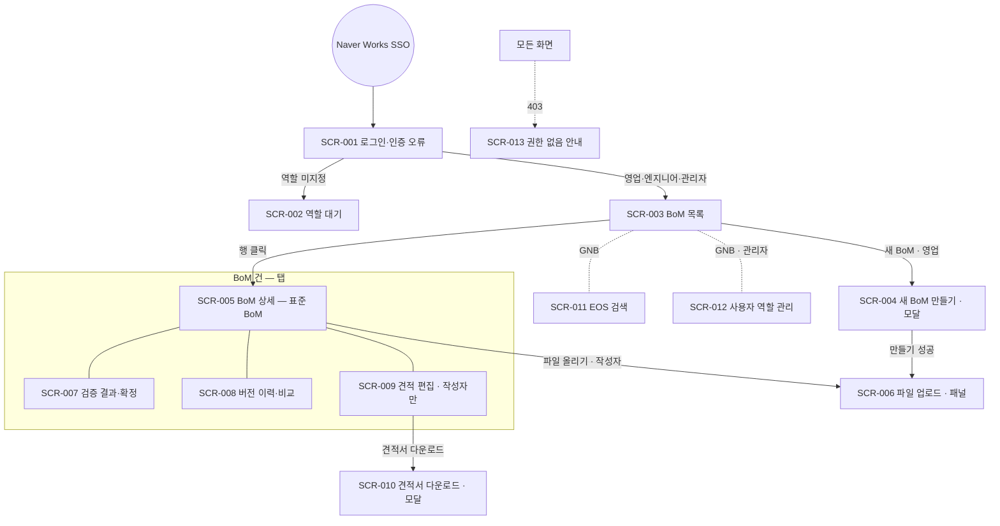
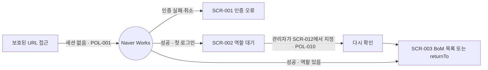
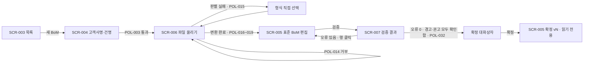
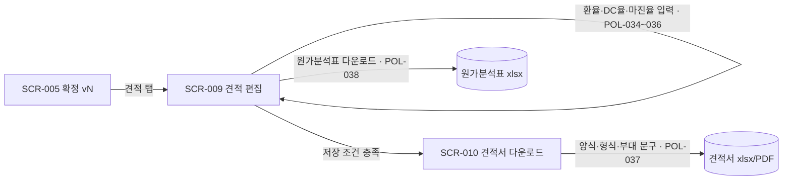
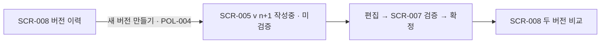
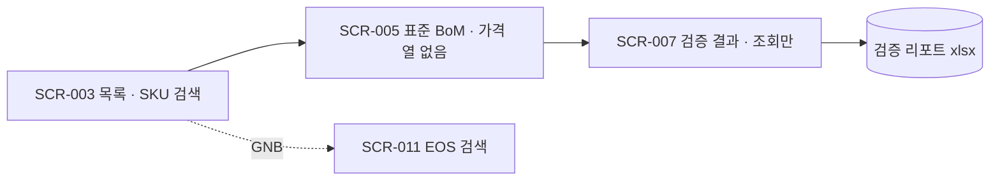

# 정보구조(IA) & 화면 목록 — BoM 자동 작성·검증 서비스 (bom-auto)

| 항목 | 내용 |
|---|---|
| 문서 버전 | v1.0 |
| 상태 | 승인 |
| 작성일 | 2026-09-30 |
| 기준 문서 | [01-prd.md](01-prd.md) v0.5, [02-policy.md](02-policy.md) v0.3 |
| 관련 문서 | [01-prd.md](01-prd.md), [02-policy.md](02-policy.md), [04-screens/](04-screens/) — 뷰어 [04-screens/index.html](04-screens/index.html) |

> **범위**: P0 요구사항(REQ-001 ~ REQ-020, REQ-028)의 화면 13개다. P1·P2(REQ-021 ~ REQ-027) 화면은 2차 기획에서 추가한다.
> **환경**: PC Chrome·Edge, 화면 폭 1280px 이상(NFR-010). 목업도 1280px 기준이다.

## 1. 사이트맵

## 2. 화면 목록

| ID | 화면명 | 경로(URL) | 접근 권한 | 관련 REQ | 정의서 | 상태 |
|---|---|---|---|---|---|---|
| SCR-001 | 로그인·인증 오류 | `/login` | 미인증 사용자 | REQ-001 | [SCR-001](04-screens/SCR-001-로그인.md) | 승인 |
| SCR-002 | 역할 대기 | `/pending` | 역할 미지정 | REQ-001, REQ-002, REQ-020 | [SCR-002](04-screens/SCR-002-역할대기.md) | 승인 |
| SCR-003 | BoM 목록 | `/boms` | 영업·엔지니어·관리자 | REQ-014 | [SCR-003](04-screens/SCR-003-BoM목록.md) | 승인 |
| SCR-004 | 새 BoM 만들기 (모달) | `/boms?new=1` | 영업 | REQ-003 | [SCR-004](04-screens/SCR-004-새BoM.md) | 승인 |
| SCR-005 | BoM 상세 — 표준 BoM | `/boms/{bomId}/v/{n}` | 조회: 3역할 / 편집: 작성자(영업) | REQ-005, REQ-006, REQ-008, REQ-012, REQ-013, REQ-015 | [SCR-005](04-screens/SCR-005-BoM상세.md) | 승인 |
| SCR-006 | 파일 업로드·형식 판별 (패널) | `/boms/{bomId}/v/{n}?upload=1` | 작성자(영업), 작성중 버전 | REQ-004, REQ-005 | [SCR-006](04-screens/SCR-006-파일업로드.md) | 승인 |
| SCR-007 | 검증 결과·확정 | `/boms/{bomId}/v/{n}/validation` | 조회: 3역할 / 실행·확인함·확정: 작성자(영업) | REQ-007 ~ REQ-011 | [SCR-007](04-screens/SCR-007-검증결과.md) | 승인 |
| SCR-008 | 버전 이력·비교 | `/boms/{bomId}/versions` | 조회: 3역할 / 새 버전: 작성자(영업) | REQ-012, REQ-013 | [SCR-008](04-screens/SCR-008-버전이력.md) | 승인 |
| SCR-009 | 견적 편집 | `/boms/{bomId}/v/{n}/quotes/{quoteId}` | 작성자(영업) | REQ-009, REQ-015, REQ-016, REQ-017, REQ-028 | [SCR-009](04-screens/SCR-009-견적편집.md) | 승인 |
| SCR-010 | 견적서 다운로드 (모달) | `/boms/{bomId}/v/{n}/quotes/{quoteId}?doc=1` | 작성자(영업) | REQ-018 | [SCR-010](04-screens/SCR-010-견적서다운로드.md) | 승인 |
| SCR-011 | EOS 검색 | `/eos` | 영업·엔지니어·관리자 | REQ-019 | [SCR-011](04-screens/SCR-011-EOS검색.md) | 승인 |
| SCR-012 | 사용자 역할 관리 | `/admin/users` | 관리자 | REQ-020 | [SCR-012](04-screens/SCR-012-사용자역할관리.md) | 승인 |
| SCR-013 | 권한 없음 안내 | `/403`, `/404` | 로그인 사용자 | REQ-002 | [SCR-013](04-screens/SCR-013-권한없음.md) | 승인 |

## 3. 주요 사용자 흐름

### 흐름 1: 로그인 → 역할 지정 → 첫 사용

- 관련 요구사항: REQ-001, REQ-002, REQ-020
- 관련 정책: POL-001, POL-002, POL-010, POL-013

### 흐름 2: 벤더 BoM → 표준 BoM → 검증 → 확정 (영업)

- 관련 요구사항: REQ-003 ~ REQ-011
- 관련 정책: POL-003, POL-014 ~ POL-032

### 흐름 3: 확정 BoM → 견적 → 견적서·원가분석표 (영업, 작성자만)

- 관련 요구사항: REQ-016, REQ-017, REQ-018, REQ-028
- 관련 정책: POL-033 ~ POL-038

### 흐름 4: 고객 요구 변경 → 새 버전 (영업)

- 관련 요구사항: REQ-012
- 관련 정책: POL-004

### 흐름 5: 엔지니어의 조회

- 관련 요구사항: REQ-002, REQ-010, REQ-014, REQ-015, REQ-019
- 관련 정책: POL-008, POL-009, POL-029, POL-039

## 4. 공통 UI 요소

| 요소 | 설명 | 노출 화면 |
|---|---|---|
| GNB(상단 내비게이션) | 왼쪽부터 서비스명 「BoM 자동화」, [BoM 목록](SCR-003), [EOS 검색](SCR-011), [사용자 관리](SCR-012 — **관리자만** 표시, POL-008), 오른쪽에 「{이름} ({역할})」, [로그아웃]. 현재 화면 메뉴는 굵게 표시한다. [로그아웃]은 `POST /auth/logout` 후 SCR-001(로그아웃 상태)로 이동한다 | SCR-003, SCR-005 ~ SCR-013 (SCR-002는 서비스명·이름·로그아웃만) |
| BoM 건 헤더 | 고객사명 · 건명(굵게) · 작성자 · 생성일 · 버전 선택(드롭다운: 「v{n} {상태}」, 최신이 위) · 버전 상태 칩(작성중/확정) · 검증 상태 칩(미검증/검증 완료/재검증 필요, POL-004) | SCR-005, SCR-007, SCR-008, SCR-009 |
| BoM 건 탭 | [표준 BoM](SCR-005) · [검증 결과](SCR-007) · [버전 이력](SCR-008) · [견적](SCR-009 — **작성자(영업)에게만** 표시, POL-008·009). 탭을 바꿔도 선택한 버전은 유지된다 | SCR-005, SCR-007, SCR-008, SCR-009 |
| 판정 등급 라벨 | 「오류」(진한 배경) · 「경고」(회색 배경) · 「검토 권고」(점선 테두리). 색만으로 구분하지 않고 항상 텍스트를 함께 쓴다(NFR-009) | SCR-005, SCR-007, SCR-008 |
| 토스트 | 화면 하단 중앙, 3초 후 사라짐. 성공 안내에만 쓴다 | 전체 |
| 푸터 | 해당 없음 — 사내 업무 도구라 푸터를 두지 않는다 | — |

### 4.1 공통 상태 문구

정책서에 화면별 문구가 없는 공통 상황에 쓴다. 화면정의서는 이 문구를 인용한다.

| 상황 | 문구 | 동작 |
|---|---|---|
| 조회 실패 (서버 오류·네트워크) | 「데이터를 불러오지 못했습니다. 다시 시도해 주세요.」 | [다시 시도] |
| 저장·실행 실패 (서버 오류) | 「요청을 처리하지 못했습니다. 잠시 후 다시 시도해 주세요.」 (POL-011과 같은 문구) | 입력값 유지 |
| 세션 만료 (API 401) | 「로그인 시간이 만료되었습니다. 다시 로그인해 주세요.」 (POL-001) | SCR-001로 이동 |
| 권한 없음 (API 403) | 「이 기능을 사용할 권한이 없습니다.」 (POL-008) | SCR-013으로 이동 |
| 없는 주소 (404) | 「요청한 페이지를 찾을 수 없습니다.」 | SCR-013(404 상태) |
| 로딩 | 표·목록은 회색 막대 스켈레톤, 버튼 작업은 버튼 안 스피너와 중복 클릭 방지 | — |

## 변경 이력

| 버전 | 일자 | 변경 내용 | 관련 CR |
|---|---|---|---|
| v0.1 | 2026-09-30 | 최초 작성. P0 화면 13개(SCR-001 ~ SCR-013), 사용자 흐름 5개, 공통 UI·공통 상태 문구 | - |
| v1.0 | 2026-10-01 | 최초 승인(화면 13개, 흐름 5개). 이후 변경은 CR 절차(/change)로 반영 | - |
