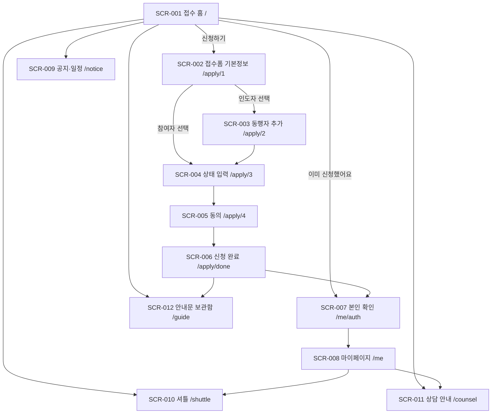
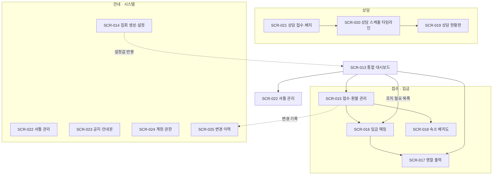
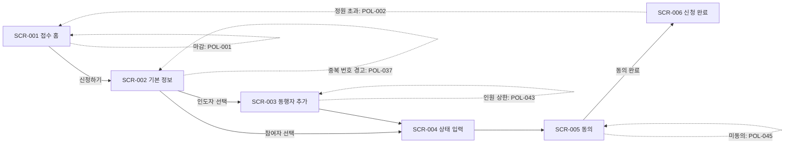
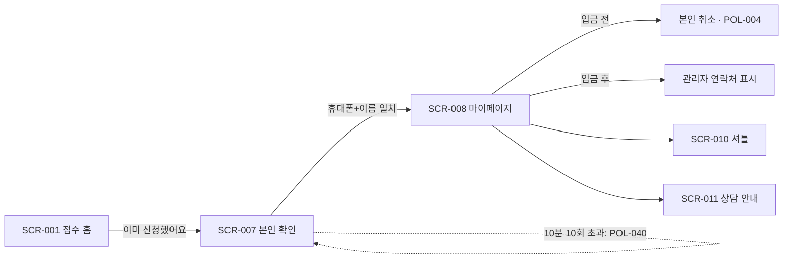
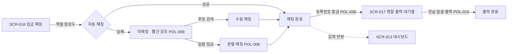
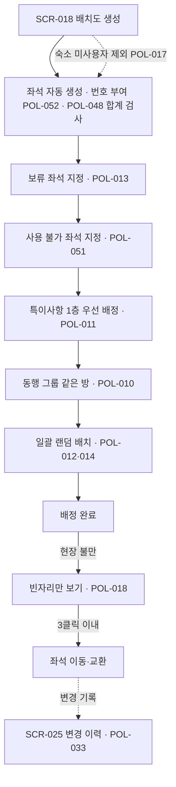
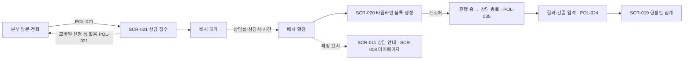
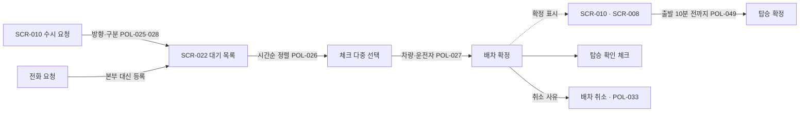
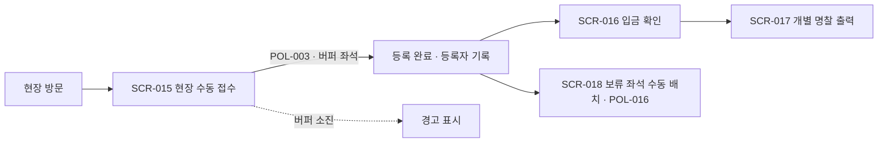

# 정보구조(IA) & 화면 목록 — 전도집회 운영 시스템 (revival-ops)

| 항목 | 내용 |
|---|---|
| 문서 버전 | v0.3 |
| 상태 | 초안 |
| 작성일 | 2026-09-02 |
| 기준 산출물 | 화면기획 v1.13 (`전도집회_화면기획.html`) — 화면 구성과 문구를 이 산출물에서 옮겼다 |
| 근거 회의록 | [2026-09-04 기획 검토·개발 착수](minutes/2026-09-04-기획검토-개발착수.md) — D-3, D-5 |
| 관련 문서 | [01-prd.md](01-prd.md), [02-policy.md](02-policy.md), [04-screens/](04-screens/) |

## 0. 화면 ID 매핑

원본 화면기획의 화면ID(U1~U12, A1~A13)를 SCR 번호로 승계했다. 순서를 그대로 두어 원본과 대조하기 쉽게 했다.

| 구분 | 원본 | SCR | 기기 |
|---|---|---|---|
| 사용자 | U1 ~ U12 | SCR-001 ~ SCR-012 | 모바일 웹 (폭 360px 기준) |
| 관리자 | A1 ~ A13 | SCR-013 ~ SCR-025 | PC 웹 (폭 1280px 기준) |

## 1. 사이트맵

### 1.1 사용자 (모바일)

하단 탭 4개(접수 · 공지/일정 · 셔틀 · 마이페이지)는 모든 사용자 화면에 상시 노출된다(4장 공통 UI).

### 1.2 관리자 (PC)

왼쪽 사이드 내비게이션은 모든 관리자 화면에 상시 노출되며, 계정 권한에 따라 항목이 숨겨진다(POL-031).

## 2. 화면 목록

### 2.1 사용자 화면 (12)

| ID | 화면명 | 경로(URL) | 접근 권한 | 관련 REQ | 정의서 | 상태 |
|---|---|---|---|---|---|---|
| SCR-001 | 접수 홈 | `/` | 전체 | REQ-001, REQ-003, REQ-021 | [SCR-001](04-screens/SCR-001-접수홈.md) | 초안 |
| SCR-002 | 접수폼 — 기본 정보 | `/apply/1` | 전체 (접수 기간 내) | REQ-004, REQ-005 | [SCR-002](04-screens/SCR-002-접수폼-기본정보.md) | 초안 |
| SCR-003 | 동행자 추가 | `/apply/2` | 전체 (인도자 선택 시) | REQ-006, REQ-007 | [SCR-003](04-screens/SCR-003-동행자추가.md) | 초안 |
| SCR-004 | 상태 입력 | `/apply/3` | 전체 | REQ-008, REQ-009 | [SCR-004](04-screens/SCR-004-상태입력.md) | 초안 |
| SCR-005 | 동의 | `/apply/4` | 전체 | REQ-010 | [SCR-005](04-screens/SCR-005-동의.md) | 초안 |
| SCR-006 | 신청 완료 | `/apply/done` | 전체 | REQ-011, REQ-034 | [SCR-006](04-screens/SCR-006-신청완료.md) | 초안 |
| SCR-007 | 본인 확인 | `/me/auth` | 전체 | REQ-012 | [SCR-007](04-screens/SCR-007-본인확인.md) | 초안 |
| SCR-008 | 마이페이지 | `/me` | 본인 확인 통과자 | REQ-013, REQ-014 | [SCR-008](04-screens/SCR-008-마이페이지.md) | 초안 |
| SCR-009 | 공지 · 일정 | `/notice` | 전체 | REQ-015 | [SCR-009](04-screens/SCR-009-공지일정.md) | 초안 |
| SCR-010 | 셔틀 신청 · 조회 | `/shuttle` | 전체 | REQ-017, REQ-018 | [SCR-010](04-screens/SCR-010-셔틀.md) | 초안 |
| SCR-011 | 상담 안내 | `/counsel` | 전체 | REQ-019 | [SCR-011](04-screens/SCR-011-상담안내.md) | 초안 |
| SCR-012 | 안내문 보관함 | `/guide` | 전체 | REQ-016 | [SCR-012](04-screens/SCR-012-안내문보관함.md) | 초안 |

### 2.2 관리자 화면 (13)

| ID | 화면명 | 경로(URL) | 접근 권한 | 관련 REQ | 정의서 | 상태 |
|---|---|---|---|---|---|---|
| SCR-013 | 통합 대시보드 | `/admin/dashboard` | 로그인 관리자 전원 | REQ-070, REQ-071 | [SCR-013](04-screens/SCR-013-통합대시보드.md) | 초안 |
| SCR-014 | 집회 생성 · 설정 | `/admin/conferences` | 본부 이상 | REQ-001, REQ-002, REQ-020, REQ-021 | [SCR-014](04-screens/SCR-014-집회설정.md) | 초안 |
| SCR-015 | 접수 · 환불 관리 | `/admin/registrants` | 본부 이상 | REQ-022~REQ-028 | [SCR-015](04-screens/SCR-015-접수환불관리.md) | 초안 |
| SCR-016 | 입금 매칭 | `/admin/payments` | 본부 이상 | REQ-029~REQ-034 | [SCR-016](04-screens/SCR-016-입금매칭.md) | 초안 |
| SCR-017 | 명찰 출력 | `/admin/badges` | 본부 이상 | REQ-035, REQ-036, REQ-037 | [SCR-017](04-screens/SCR-017-명찰출력.md) | 초안 |
| SCR-018 | 숙소 배치도 | `/admin/lodging` | 본부 이상 | REQ-038~REQ-047, REQ-072 | [SCR-018](04-screens/SCR-018-숙소배치도.md) | 초안 |
| SCR-019 | 상담 현황판 | `/admin/counseling` | 본부 이상 | REQ-055, REQ-056 | [SCR-019](04-screens/SCR-019-상담현황판.md) | 초안 |
| SCR-020 | 상담 스케줄 (타임라인) | `/admin/counseling/schedule` | 본부 이상 | REQ-050~REQ-054 | [SCR-020](04-screens/SCR-020-상담스케줄.md) | 초안 |
| SCR-021 | 상담 접수 · 배치 | `/admin/counseling/registration` | 본부 이상 | REQ-048, REQ-049, REQ-050 | [SCR-021](04-screens/SCR-021-상담접수배치.md) | 초안 |
| SCR-022 | 셔틀 관리 | `/admin/shuttle` | 본부 이상 + 셔틀팀 | REQ-057~REQ-061 | [SCR-022](04-screens/SCR-022-셔틀관리.md) | 초안 |
| SCR-023 | 공지 · 안내문 | `/admin/content` | 본부 이상 | REQ-062, REQ-063, REQ-064 | [SCR-023](04-screens/SCR-023-공지안내문.md) | 초안 |
| SCR-024 | 계정 · 권한 | `/admin/accounts` | 전체 어드민만 | REQ-065, REQ-066, REQ-067 | [SCR-024](04-screens/SCR-024-계정권한.md) | 초안 |
| SCR-025 | 변경 이력 | `/admin/logs` | 본부 이상 | REQ-068, REQ-069 | [SCR-025](04-screens/SCR-025-변경이력.md) | 초안 |

## 3. 주요 사용자 흐름

### 흐름 1: 신규 참가 신청 (인도자 + 동행자)

- 관련 요구사항: REQ-001~REQ-011
- 관련 정책: POL-001, POL-002, POL-037, POL-042, POL-043, POL-045

### 흐름 2: 재방문 — 내 신청 확인

- 관련 요구사항: REQ-012, REQ-013, REQ-014
- 관련 정책: POL-004(검토중), POL-007, POL-029, POL-040

### 흐름 3: 입금 확인 → 등록번호 → 명찰

- 관련 요구사항: REQ-029~REQ-036, REQ-070
- 관련 정책: POL-008, POL-009, POL-019, POL-038, POL-047

### 흐름 4: 숙소 배정 (집회 1~2일 전)

- 관련 요구사항: REQ-038~REQ-047, REQ-072
- 관련 정책: POL-010~POL-018, POL-033, POL-048, POL-051, POL-052

### 흐름 5: 상담 — 접수에서 결과까지

- 관련 요구사항: REQ-019, REQ-048~REQ-056
- 관련 정책: POL-021, POL-022(미확정), POL-023(미확정), POL-024, POL-035, POL-036

### 흐름 6: 셔틀 요청 → 배차 → 탑승

- 관련 요구사항: REQ-017, REQ-018, REQ-057~REQ-061
- 관련 정책: POL-025, POL-026, POL-027, POL-028, POL-049

### 흐름 7: 현장 방문자 수동 접수 (접수 마감 이후)

- 관련 요구사항: REQ-023, REQ-035, REQ-044
- 관련 정책: POL-002, POL-003, POL-016, POL-019, POL-044

## 4. 공통 UI 요소

### 4.1 사용자 (모바일)

| 요소 | 설명 | 노출 화면 |
|---|---|---|
| 상단 헤더 | 집회명(작게) + 화면 제목(크게). 진한 배경 | 전체 |
| 하단 탭바 | 접수 · 공지/일정 · 셔틀 · 마이페이지 4개. 현재 탭 강조 | SCR-001, 008~012 |
| 단계 진행 바 | 접수폼 4단계 진행률(1/4 ~ 4/4) | SCR-002 ~ SCR-005 |
| 안내 박스(hint) | 회색 배경 보조 설명. 본문 대비 한 단계 작은 글자 | 전체 |
| 상태 배지 | 확인(초록) / 대기(노랑) / 미매칭(빨강) / 해당 없음(회색) | SCR-008, 010, 011 |
| 주요 버튼 | 화면 폭 100%, 높이 54px 이상 (NFR-007 터치 영역) | 전체 |

### 4.2 관리자 (PC)

| 요소 | 설명 | 노출 화면 |
|---|---|---|
| 좌측 사이드 내비 | 현재 집회명 + 메뉴 13개. 권한 없는 메뉴는 숨김(POL-031) | 전체 |
| 상단 페이지 헤더 | 화면명 + 기준 시각/브레드크럼 | 전체 |
| 툴바 | 검색 입력 + 필터 탭 + 우측 주요 액션 버튼 | SCR-015~018, 021~025 |
| 데이터 테이블 | 체크박스 열 + 상태 칩 + 행 액션 버튼(POL-005) | SCR-015~017, 022, 024, 025 |
| 상태 칩 | 매칭(초록) / 부분 매칭(노랑) / 미매칭(빨강, 행 배경 강조) — POL-009 | SCR-013, 015, 016 |
| 모달 | 확인·입력 팝업. 배경 클릭 또는 ESC로 닫힘 | SCR-015~018, 020~024 |
| 토스트 | 처리 결과 알림. 3초 후 자동 사라짐 | 전체 |
| 이력 버튼 | 건별 변경 이력 팝업(POL-033, REQ-069) | SCR-015~018, 020, 022 |

## 5. 목업 구현 메모

- 목업은 `04-screens/`에 화면당 `.md` + `.html` 쌍으로 둔다. `04-screens/index.html`이 전체 목록 뷰어다.
- 공통 스타일과 공통 동작은 `04-screens/_wf.css`, `04-screens/_wf.js`에 두고 각 목업이 참조한다. 25개 파일에 같은 CSS를 복사하지 않기 위한 것이며, 목업 파일은 화면 고유 구조에만 집중한다.
- **관리자 목업은 화면 안 상태 전이까지 동작한다.** 탭·필터·검색·체크박스·모달이 실제로 반응하고, 목업 안 모의 데이터의 상태가 바뀐다(예: 미매칭을 수동 매칭하면 칩이 초록으로 바뀌고 상단 집계가 줄어든다). 원본 화면기획에서 `alert()`으로 처리되던 지점을 실제 동작으로 바꾼 부분이다.
- **화면 간 이동도 동작한다.** 하단 탭·사이드 내비·단계 이동 버튼·대시보드 조치 목록이 실제로 해당 목업 파일로 이동한다(`_wf.js`의 `SCREEN_FILES` 매핑). 각 목업 상단에 [☰ 화면 목록] [← 뒤로]가 붙는다.
  - 이동 시 맥락을 넘길 수 있다 — 예: SCR-013 조치 목록의 [미매칭]을 누르면 SCR-016이 「미매칭」 탭이 적용된 상태로 열린다(`goScreen(id, { context })` / 도착 화면에서 `navContext()`).
  - 목업은 화면마다 독립 파일이라 **이동하면 그 화면의 모의 데이터는 초기화된다.** 실제 구현에서는 서버에 저장되므로 이 제약은 목업에만 해당한다.
- 목업은 로파이 그레이스케일을 유지한다. 상태 구분에 필요한 최소한의 색(초록/노랑/빨강 칩)만 쓴다.

## 변경 이력

| 버전 | 일자 | 변경 내용 | 관련 CR |
|---|---|---|---|
| v0.1 | 2026-09-02 | 최초 작성. 화면기획 v1.13의 25화면을 SCR-001~025로 승계, 사이트맵 2종·사용자 흐름 7종·공통 UI 정의 | - |
| v0.2 | 2026-09-02 | 목업 화면 간 이동 구현. 5장 구현 메모에 이동 방식·맥락 전달·데이터 초기화 제약 추가 | - |
| v0.3 | 2026-09-04 | 2026-09-04 회의 결정 반영(D-3, D-5). 흐름 4(숙소)에 사용 불가 좌석 지정 단계(POL-051)와 좌석 번호 부여(POL-052) 추가, SCR-018 요구사항 범위에 REQ-072 반영 | - |
