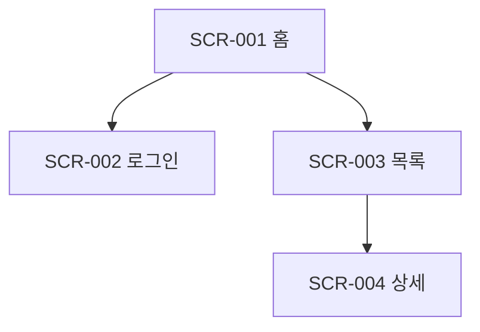
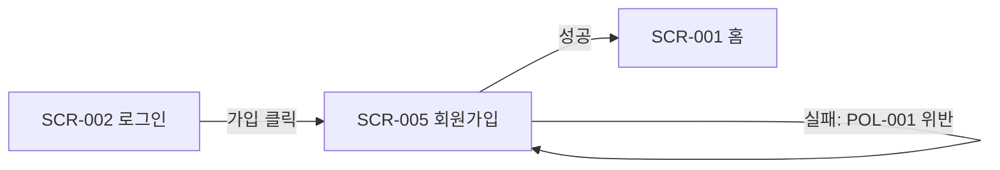

# 정보구조(IA) & 화면 목록 — {프로젝트명}

| 항목 | 내용 |
|---|---|
| 문서 버전 | v0.1 |
| 상태 | 초안 |
| 작성일 | YYYY-MM-DD |
| 관련 문서 | [01-prd.md](01-prd.md), [04-screens/](04-screens/) |

## 1. 사이트맵

## 2. 화면 목록

| ID | 화면명 | 경로(URL) | 접근 권한 | 관련 REQ | 정의서 | 상태 |
|---|---|---|---|---|---|---|
| SCR-001 | | / | 전체 | REQ-001 | [SCR-001](04-screens/SCR-001-홈.md) | 초안 |

## 3. 주요 사용자 흐름

### 흐름 1: {흐름명} (예: 회원가입 → 첫 이용)

- 관련 요구사항: REQ-###
- 관련 정책: POL-###

## 4. 공통 UI 요소

| 요소 | 설명 | 노출 화면 |
|---|---|---|
| GNB(상단 내비게이션) | | 전체 |
| 푸터 | | 전체 |

## 변경 이력

| 버전 | 일자 | 변경 내용 | 관련 CR |
|---|---|---|---|
| v0.1 | YYYY-MM-DD | 최초 작성 | - |
